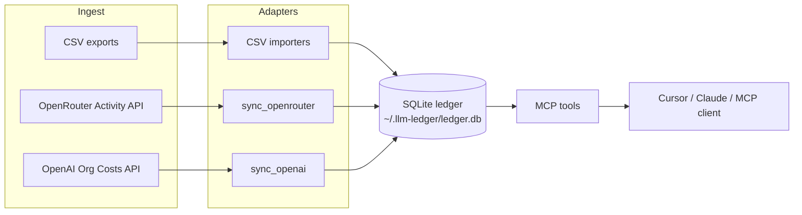

# llm-ledger

**Local-first FinOps ledger for AI spend — queryable by agents via MCP.**

LLM usage is scattered across provider dashboards and CSVs. Those surfaces don’t compose into agent workflows, so answering “what did project X cost this month?” still means manual export and spreadsheet glue.

`llm-ledger` ingests provider usage (CSV, OpenRouter Activity, OpenAI Organization Costs) into a local SQLite database and exposes budget, invoice, and spend tools over the [Model Context Protocol](https://modelcontextprotocol.io/). It is **not** an LLM gateway: it does not proxy prompts.

Designed and shipped as an independent TypeScript MCP server for contractors and small teams who need spend visibility without sending ledger data to a third-party SaaS.

## Architecture



See [docs/architecture.md](./docs/architecture.md) for failure modes, idempotency keys, and design decisions. Short ADR: [docs/adr/0001-local-sqlite-mcp.md](./docs/adr/0001-local-sqlite-mcp.md).

## Why MCP

Dashboards answer humans. Agents need tools: *sync OpenRouter*, *check budget for acme*, *invoice summary for September*. Keeping the ledger local means cost data stays on the machine that runs the MCP server.

## Security model

| Concern | Behavior |
|---------|----------|
| Ledger data | Local SQLite only (`LLM_LEDGER_DB` override). No cloud sync. No telemetry. |
| API keys | Read from env (or optional tool arg) **at sync time only**. Never written to SQLite. Never echoed in tool results. |
| OpenRouter | Requires a **Management / provisioning** key — inference keys get 401/403. |
| OpenAI | Requires an **Organization Admin** key — project `sk-` keys will not work. |
| Least privilege | Create keys scoped to management/admin APIs only; rotate if exposed. |

Do not commit `.env`, keys, or `ledger.db`.

## Install

```bash
git clone https://github.com/Zacsladden1/llm-ledger.git
cd llm-ledger
npm install
npm run build
```

Requires **Node.js 20+**. Native module `better-sqlite3` needs build tools on some platforms (Xcode CLT on macOS, `build-essential` + Python on Linux).

## MCP tools

| Tool | Purpose |
|------|---------|
| `import_csv` | Import a usage CSV (`openai` / `anthropic` / `openrouter`) |
| `sync_openrouter` | Pull OpenRouter Activity spend (Management key) |
| `sync_openai` | Pull OpenAI Organization Costs (Admin key) |
| `spend_this_month` | Total spend for current month (or `YYYY-MM`) |
| `spend_by_project` | Spend breakdown by project |
| `invoice_summary` | Lines by provider + model (+ project) |
| `set_budget` | Set monthly USD budget for a project |
| `check_budget` | Compare MTD spend vs budget |
| `list_imports` | List CSV / sync import batches |

### Example agent prompts

- *Sync OpenRouter for the last 30 days.*
- *Import this OpenAI CSV tagged as project `acme`.*
- *Set budget for acme to $150/month, then check budget.*
- *Invoice summary for September by model.*

### CSV columns (resilient aliases)

Importers tolerate common export header names. Cost is optional — when missing, a built-in pricing fallback map estimates USD from tokens (approximate public list rates; prefer CSVs that include USD).

**OpenAI** — `date` / `usage_date` / `timestamp`, `model`, `input_tokens` / `prompt_tokens`, `output_tokens` / `completion_tokens`, optional `cost` / `cost_usd`, optional `project`.

**Anthropic** — `date` / `created_at`, `model`, `input_tokens` / `tokens_input`, `output_tokens` / `tokens_output`, optional `cost` / `spend`, optional `project` / `workspace`.

**OpenRouter** — `date` / `created_at` / `generation_time`, `model`, `prompt_tokens` / `input_tokens`, `completion_tokens` / `output_tokens`, optional `cost`, optional `project` / `app`.

## Database

- Default path: `~/.llm-ledger/ledger.db`
- Override: `LLM_LEDGER_DB=/path/to/ledger.db`

## OpenRouter Activity sync (`sync_openrouter`)

OpenRouter’s `/api/v1/activity` (and analytics) endpoints require a **Management API key**. Ordinary inference / chat keys return **401/403**.

1. Create a Management key at [openrouter.ai/settings/management-keys](https://openrouter.ai/settings/management-keys).
2. Set `OPENROUTER_MANAGEMENT_KEY` in MCP server `env` (preferred), or pass `api_key` once (never logged).
3. Call with optional `since` / `until` (`YYYY-MM-DD`) or `project`.

Sync is **idempotent**: rows keyed by day + model + endpoint (+ workspace when present). Re-runs skip duplicates and record an import batch via `list_imports`. Activity covers roughly the last 30 completed UTC days.

## OpenAI Costs sync (`sync_openai`)

OpenAI’s `/v1/organization/costs` endpoint requires an **Organization Admin API key**. Regular project `sk-` keys **will not work**.

1. Create an Admin key at [platform.openai.com/settings/organization/admin-keys](https://platform.openai.com/settings/organization/admin-keys).
2. Set `OPENAI_ADMIN_KEY` in MCP `env` (preferred), or pass `api_key` once.
3. Optional args: `since` / `until`, `start_time` (unix), `limit` (1–180), `project`.

Idempotency key shape: `oai:costs:{date}:{line_item|project|bucket}`. v0.3 is **costs-only** (token columns are 0).

### Example Cursor MCP config

```json
{
  "mcpServers": {
    "llm-ledger": {
      "command": "node",
      "args": ["/absolute/path/to/llm-ledger/dist/index.js"],
      "env": {
        "LLM_LEDGER_DB": "/absolute/path/to/optional-custom.db",
        "OPENROUTER_MANAGEMENT_KEY": "sk-or-…",
        "OPENAI_ADMIN_KEY": "sk-admin-…"
      }
    }
  }
}
```

### npx (once published)

```json
{
  "mcpServers": {
    "llm-ledger": {
      "command": "npx",
      "args": ["--yes", "llm-ledger"]
    }
  }
}
```

See [PUBLISH.md](./PUBLISH.md) for registry release steps.

## Claude Desktop

Edit `claude_desktop_config.json` with the same `command` / `args` pattern as above.

## Scripts

```bash
npm run build   # TypeScript → dist/
npm test        # vitest (CSV parse, aggregation, sync mocks)
npm start       # MCP server on stdio
```

## Roadmap

- npm package for one-line `npx` install
- Additional provider cost adapters as APIs stabilize
- Richer project tagging / multi-workspace reporting

## License

MIT — see [LICENSE](./LICENSE).

## Attribution

TypeScript MCP server using [@modelcontextprotocol/sdk](https://github.com/modelcontextprotocol/typescript-sdk), [better-sqlite3](https://github.com/WiseLibs/better-sqlite3), and [csv-parse](https://github.com/adaltas/node-csv).
