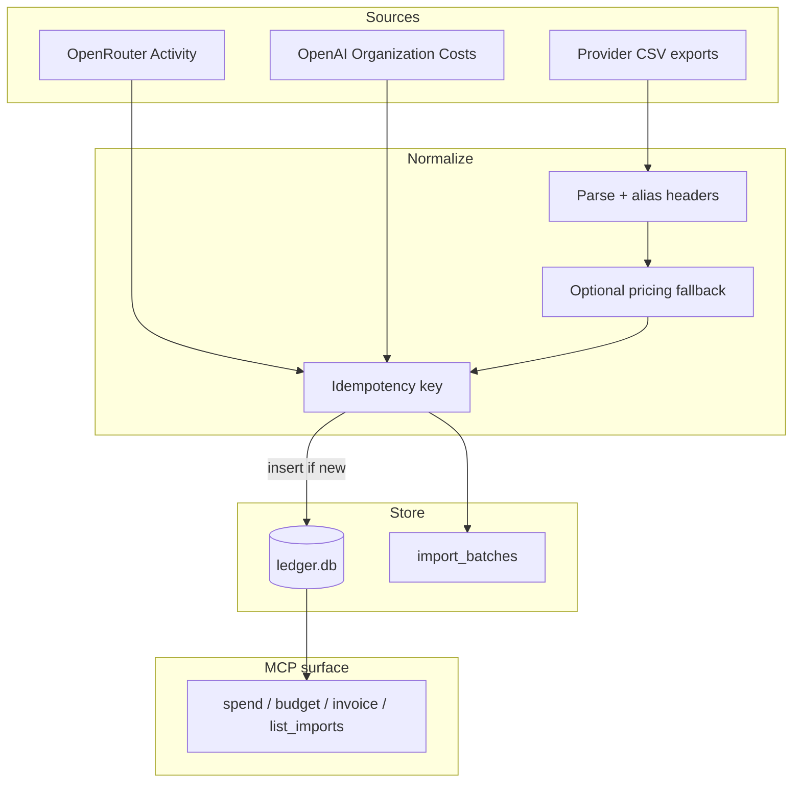

# Architecture

## Overview

`llm-ledger` is a local-first spend ledger with MCP as the query surface.

1. **Ingest** usage from CSV files or provider cost/activity APIs.
2. **Normalize** into a common usage row shape (provider, model, day, tokens, USD, project).
3. **Persist** in SQLite under `~/.llm-ledger/` (or `LLM_LEDGER_DB`).
4. **Expose** aggregation and budget tools over MCP stdio.

It does not sit in the prompt path. Keys are only used during sync.

## Data flow

## Idempotency

Re-running sync or import must not double-count spend.

| Source | Key idea |
|--------|----------|
| OpenRouter Activity | day + model + endpoint (+ workspace when present) |
| OpenAI Costs | `oai:costs:{date}:{line_item\|project\|bucket}` |
| CSV | Importer-defined row identity + import batch record |

Each successful ingest records an **import batch** visible via `list_imports`.

## Failure modes

| Failure | What happens | Operator action |
|---------|----------------|-----------------|
| Wrong key type (inference instead of Management/Admin) | 401/403 from provider | Create the correct key scope; set env var |
| Rate limits / transient HTTP errors | Sync aborts for that run; prior committed rows remain | Retry later; re-run is idempotent |
| Partial sync window | Only returned pages/days land | Re-run with overlapping `since`/`until`; duplicates skipped |
| CSV missing cost column | Pricing fallback estimates USD | Prefer exports that include provider cost |
| Duplicate invoice lines after bad keying | Would inflate spend | Rely on idempotency keys; inspect `list_imports` and DB if suspect |
| OpenRouter Activity lag | API covers ~last 30 completed UTC days | Don’t expect realtime same-day completeness |
| OpenAI costs-only rows | Token columns are 0 in v0.3 | Use costs for money; tokens from CSV if needed |

## Design decisions

### SQLite vs Postgres

SQLite keeps the product local-first: zero ops, single file, fits MCP-on-a-laptop. Contractors don’t need a hosted DB for a personal/agency ledger. Postgres would make sense for multi-user shared ledgers later; not the v0 goal.

### Management / Admin keys vs user inference keys

Provider cost APIs are gated. Documenting the failure mode (401/403 with `sk-` chat keys) is part of the product surface so agents and humans fail closed with a clear fix.

### MCP vs another dashboard

The differentiator is **in-context tools** for agents already running in Cursor/Claude Desktop. A dashboard would compete with provider UIs; MCP composes with agent workflows.

### No telemetry / no ledger upload

Spend data is sensitive. The server neither phones home nor syncs the DB. That constraint drives the local SQLite choice.

## Module map (high level)

| Area | Role |
|------|------|
| `src/index.ts` | MCP server entry, tool registration |
| `src/db.ts` | Schema, queries, import batches |
| `src/pricing.ts` | Fallback USD estimates |
| `src/importers/` | CSV parsers per provider |
| `src/tools/` | MCP tool handlers (sync, spend, budget, …) |

Exact paths may evolve; treat this as orientation, not a frozen tree.

## Security notes

- Never log API keys or full Authorization headers.
- Prefer env-based keys in MCP config over passing `api_key` in chat transcripts.
- Keep `ledger.db` out of git and backups that leave the machine without encryption.
